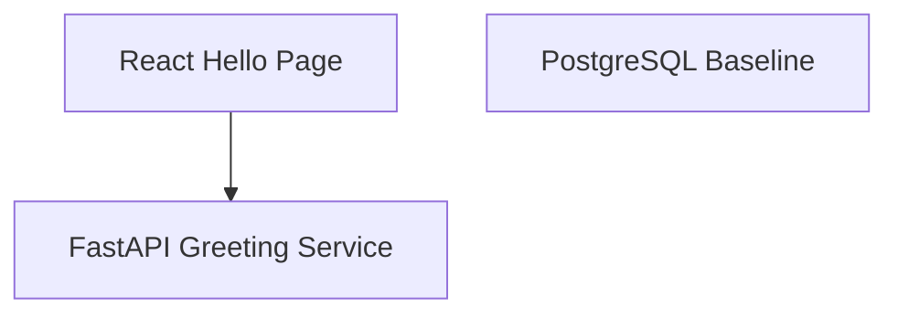
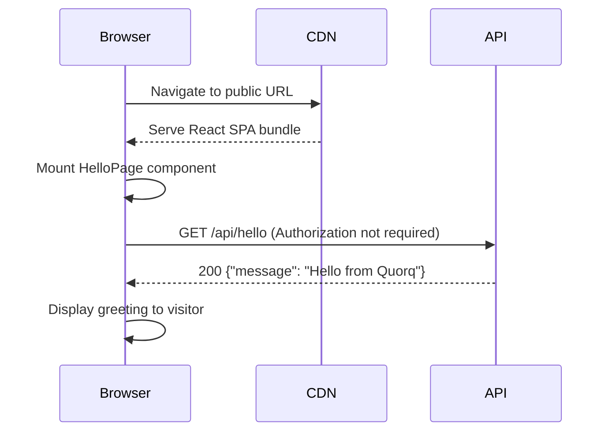
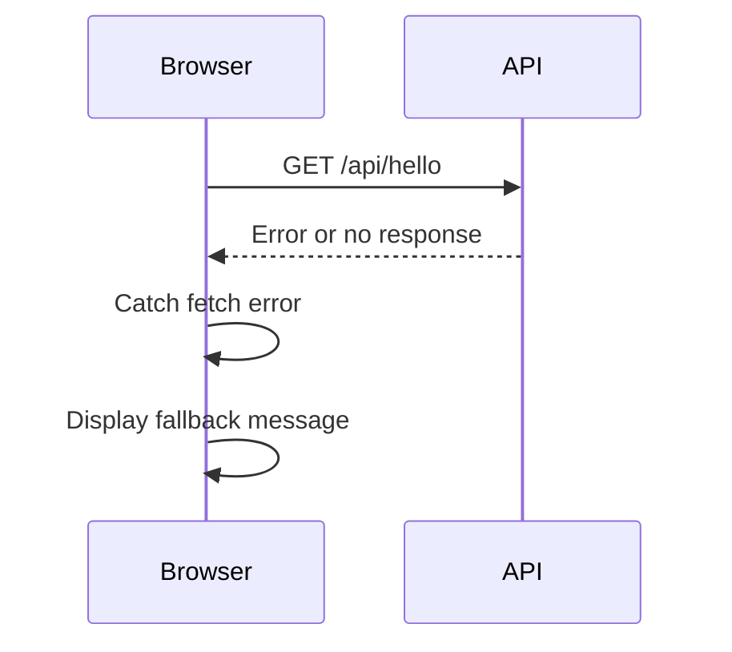
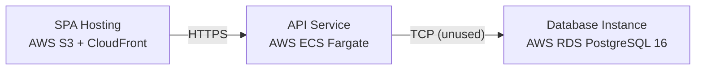

# Architecture

> Maintained by QuorQ AI SDLC. Text between `sdlc:auto` markers is regenerated; anything outside them is yours and is kept.

<!-- sdlc:auto:start narrative -->
## Overview

### ARCH-001 · approved · source: architecture:version-1

Architecture overview and approval for the Hello App smoke-test web app at version 1. The React 19 frontend loads a greeting from the FastAPI backend's GET /api/hello endpoint on page load and displays it, falling back to a static message if the fetch fails. No authentication, no database tables, and no additional features. PostgreSQL 16 is provisioned as the approved database baseline but remains unused for this user story. Frontend and API are deployed on AWS as two separate origins, each reachable at its own public URL.

Status: approved. Version: 1. The architecture covers a single user story (US-001). The system consists of three components (frontend, API, database), two critical paths (happy-path greeting display and fetch-failure fallback), one public endpoint (GET /api/hello), three deployment nodes (SPA hosting, API service, database instance), and four technology decisions (React 19, FastAPI 0.115, PostgreSQL 16, AWS). All technology decisions were approved by the product owner.

**Related:** US-001

### ARCH-002 · approved · source: architecture:version-1:components

Three components are defined: a React 19 Hello Page frontend, a FastAPI 0.115 Greeting Service API, and a PostgreSQL 16 Baseline database that is provisioned but unused.

• frontend: React Hello Page (React 19) — Renders a single public page that fetches the greeting from GET /api/hello on load and displays it, showing a fallback message if the fetch fails.
• api: FastAPI Greeting Service (FastAPI 0.115) — Serves a single public GET /api/hello endpoint that returns the hard-coded JSON greeting {"message": "Hello from Quorq"} with HTTP 200.
• database: PostgreSQL Baseline (PostgreSQL 16) — Provisioned as the approved database baseline but unused for this smoke test. No tables are created and no queries are issued.

**Related:** US-001, ARCH-001

### ARCH-003 · approved · source: architecture:version-1:critical-paths

Two critical paths are defined: the happy path where a visitor loads the Hello page and sees the greeting, and the fallback path where a failed fetch displays a static message with no retry.

• Visitor loads Hello page and sees greeting: A visitor navigates to the public URL, the React page mounts, fetches GET /api/hello, and displays the returned message. If the fetch fails, a fallback message is shown.
• Fetch failure fallback: When the greeting fetch fails (backend unreachable or error response), the page displays a basic fallback message with no retry or additional error handling.

**Related:** US-001, ARCH-001, ARCH-002, ARCH-004

### ARCH-004 · approved · source: architecture:version-1:endpoints

One public API endpoint is defined: GET /api/hello returns the hard-coded greeting message as JSON with no authentication required.

GET /api/hello — Returns the hard-coded greeting message as JSON ("message": "Hello from Quorq"). Fully public, no authentication required. HTTP 200 on success.

**Related:** US-001, ARCH-001, ARCH-002

### ARCH-005 · approved · source: architecture:version-1:deployment-nodes

Three AWS deployment nodes are defined: SPA static hosting via S3 + CloudFront, an API service on ECS Fargate behind an ALB, and a managed RDS PostgreSQL 16 instance.

• SPA Hosting: AWS S3 + CloudFront, static file hosting for the React 19 build output.
• API Service: AWS ECS Fargate, FastAPI 0.115 behind an Application Load Balancer, uvicorn server.
• Database Instance: AWS RDS PostgreSQL 16, managed PostgreSQL instance (provisioned but unused for this smoke test).

**Related:** US-001, ARCH-001, ARCH-002

### ARCH-006 · approved · source: architecture:version-1:technology-decisions

Four technology decisions were approved by the product owner: React 19 for frontend, FastAPI 0.115 for backend, PostgreSQL 16 as database baseline, and AWS for cloud hosting.

• Frontend: React 19 (alternatives: Vue 3, Svelte 5) — Approved by the product owner. A single-page smoke test with one fetch call and a fallback display fits React's component model cleanly and gives a foundation to grow if features are added later.
• Backend: FastAPI 0.115 (alternatives: Node.js/Express, Flask) — Approved by the product owner as the closest available option to the originally confirmed Node.js/Express assumption. FastAPI serves the single GET /api/hello endpoint with minimal code and returns the hard-coded JSON greeting cleanly.
• Database: PostgreSQL 16 (alternatives: SQLite) — Approved by the product owner as the platform default for the database layer. No database is needed for this smoke test, but PostgreSQL 16 is named as the baseline so the delivery pipeline can provision it.
• Cloud: AWS (alternatives: GCP, Azure) — Approved by the product owner. AWS provides a stable public URL and a deployment target that exercises the full delivery pipeline end to end, which is the purpose of this project.

**Related:** US-001, ARCH-001
<!-- sdlc:auto:end narrative -->

<!-- sdlc:auto:start building-blocks -->
## Building Block View

| ID | Name | Technology | Responsibility | Depends on |
|---|---|---|---|---|
| frontend | React Hello Page | React 19 | Render a single public page that fetches the greeting from GET /api/hello on load and displays it, showing a fallback message if the fetch fails. | api |
| api | FastAPI Greeting Service | FastAPI 0.115 | Serve a single public GET /api/hello endpoint that returns the hard-coded JSON greeting {"message": "Hello from Quorq"} with HTTP 200. | — |
| database | PostgreSQL Baseline | PostgreSQL 16 | Provisioned as the approved database baseline but unused for this smoke test. No tables are created and no queries are issued. | — |

<!-- sdlc:auto:end building-blocks -->

<!-- sdlc:auto:start runtime -->
## Runtime View

### Visitor loads Hello page and sees greeting

A visitor navigates to the public URL, the React page mounts, fetches GET /api/hello, and displays the returned message. If the fetch fails, a fallback message is shown.

- **Components:** frontend, api
- **Modules:** src/HelloPage.tsx, src/main.tsx, app/main.py, app/routes/hello.py
- **Key functions:** HelloPage(), useEffect(fetchGreeting), get_hello()

### Fetch failure fallback

When the greeting fetch fails (backend unreachable or error response), the page displays a basic fallback message with no retry or additional error handling.

- **Components:** frontend, api
- **Modules:** src/HelloPage.tsx
- **Key functions:** HelloPage(), handleFetchError()

<!-- sdlc:auto:end runtime -->

<!-- sdlc:auto:start deployment-view -->
## Deployment View

| Name | Service | Runtime | Scaling | Environment |
|---|---|---|---|---|
| SPA Hosting | AWS S3 + CloudFront | Static file hosting (React 19 build output) | CDN-managed, auto-scales | dev |
| API Service | AWS ECS Fargate | FastAPI 0.115 behind Application Load Balancer, uvicorn server | Single task for smoke test | dev |
| Database Instance | AWS RDS PostgreSQL 16 | Managed PostgreSQL instance | Single instance, provisioned but unused | dev |

| Source | Target | Protocol |
|---|---|---|
| SPA Hosting | API Service | HTTPS |
| API Service | Database Instance | TCP (unused) |

<!-- sdlc:auto:end deployment-view -->

<!-- sdlc:auto:start decisions -->
## Architecture Decisions

| Layer | Choice | ADR |
|---|---|---|
| Frontend | React 19 | [ADR-0001](adr/frontend.md) |
| Backend | FastAPI 0.115 | [ADR-0002](adr/backend.md) |
| Database | PostgreSQL 16 | [ADR-0003](adr/database.md) |
| Cloud | AWS | [ADR-0004](adr/cloud.md) |
<!-- sdlc:auto:end decisions -->

<!-- sdlc:auto:start links -->
## Related Documents

- [Data Model](data-model.md)
- [API Specification](api/openapi.yaml)
- [Architecture Decision Records](adr/README.md)
<!-- sdlc:auto:end links -->
