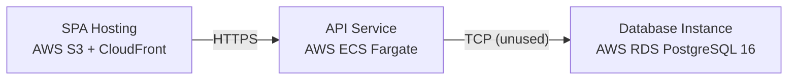

# Deployment Guide

> Maintained by QuorQ AI SDLC. Text between `sdlc:auto` markers is regenerated; anything outside them is yours and is kept.

<!-- sdlc:auto:start how-it-deploys -->
Pushes to `main` run `.github/workflows/deploy.yml`, which builds the API image (if there is a backend) and deploys the SPA to AWS Amplify. Commits touching only `docs/sdlc/**` don't deploy. Deployments can also be started from the platform's Deployment tab.
<!-- sdlc:auto:end how-it-deploys -->

<!-- sdlc:auto:start environments -->
| Name | Service | Runtime | Scaling | Environment |
|---|---|---|---|---|
| SPA Hosting | AWS S3 + CloudFront | Static file hosting (React 19 build output) | CDN-managed, auto-scales | dev |
| API Service | AWS ECS Fargate | FastAPI 0.115 behind Application Load Balancer, uvicorn server | Single task for smoke test | dev |
| Database Instance | AWS RDS PostgreSQL 16 | Managed PostgreSQL instance | Single instance, provisioned but unused | dev |
<!-- sdlc:auto:end environments -->

<!-- sdlc:auto:start live -->
_Not deployed yet._
<!-- sdlc:auto:end live -->

<!-- sdlc:auto:start topology -->

<!-- sdlc:auto:end topology -->
